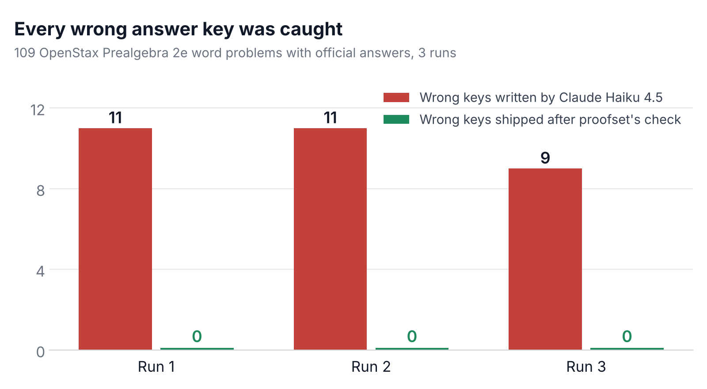

# proofset

Practice sets and a tutor from free textbooks, in English and German, where every answer key is
worked out twice by running code before a student sees it. Built with
[Strands Agents](https://strandsagents.com) on Amazon Bedrock and AWS Lambda.

## The problem

Students who need extra practice often don't get it. In under-resourced schools teachers have no
budget for workbooks and no time to write and check new problems, and students learning maths in a
second language also have to get past the wording. Free textbooks such as OpenStax help, but each
section has a limited set of exercises, mostly in English.

A language model can write new problems in seconds, in any language. It also gets some answer keys
wrong, and a wrong key does more harm than no key: the student who got it right is marked wrong,
the student who copied the mistake is marked right, and the teacher stops trusting the sheet.

proofset writes the problems with a model and checks every answer key with code.

## What it does

```
OpenStax chapter ──► author agent ──► problems with answer keys
                                         │
                       ┌─────────────────┴──────────────────┐
                 solver A (Nova Micro)               solver B (Nova Micro)
                 writes Python ──► AWS Lambda        writes Python ──► AWS Lambda
                       └─────────────────┬──────────────────┘
                                   code check (plain Python)
             both runs agree with the key ──► ship it
             both runs agree, key differs ──► back to the author once, then re-checked
             runs disagree ──► one more solve on Claude Haiku, then decide
                                         │
                           translator agent ──► German, every number must survive
                                         │
             printable worksheets (EN, DE) + answer key        tutor agent for students
```

- **Author** (Claude Haiku 4.5, Strands structured output): reads the section and writes warm-up,
  practice and challenge problems with hints and a worked solution, in everyday contexts.
- **Solvers** (Amazon Nova Micro + `run_python`): each works the problem out by writing Python
  that runs in an AWS Lambda sandbox. A key ships only when two independent runs printed the same
  value, each solver's answer matches what its own code printed, and that value matches the key.
- **Translator** (Claude Haiku 4.5): simple German (B1 level). A plain-Python check confirms the
  German text has exactly the same numbers as the English, written the German way (1.234,50 $,
  21,2 %). If a number changed, it is translated again; if it still changes, the problem stays
  English-only.
- **Worksheets**: printable A4 HTML in English and German with space for working and the answer
  key on its own page, for classrooms with a printer but not a device per student.
- **Tutor** (Nova Micro): a Strands agent the student talks to, in English or German. Its tools hold
  the verified keys, so the model never decides whether an answer is right: `check_answer` does.
  It gives one hint at a time, reveals the answer only after three tries, and logs every attempt so
  a teacher can see first-try accuracy and hints used.

## Results

**Answer keys.** [`bench/key_bench.py`](bench/key_bench.py) uses the 109 word problems in the
*Percents* chapter of OpenStax Prealgebra 2e that come with an official numeric answer. Claude
Haiku 4.5 writes each answer key from its head, the way a worksheet generator would, and proofset
checks it. Every outcome is graded against the official answer.



| | Run 1 | Run 2 | Run 3 |
| --- | ---: | ---: | ---: |
| Wrong keys written by Claude Haiku 4.5 | 11 | 11 | 9 |
| **Wrong keys shipped after proofset's check** | **0** | **0** | **0** |
| Good keys shipped | 88 | 82 | 91 |
| Good keys held back | 10 | 15 | 9 |
| LLM cost for 109 problems | $0.17 | $0.19 | $0.26 |

Across 327 checked keys, 31 were wrong and none got through. Five wrong keys per run are format
questions ("write 89% as a ratio": the book wants 0.89, the model wrote 89). The rest are real
arithmetic mistakes in the applications, for example $11,445.59 instead of $11,450 of simple
interest and 5,646 yen instead of 56,460. Results per run and per problem:
[run 1](bench/reported/keys-run1-summary.md), [run 2](bench/reported/keys-run2-summary.md),
[run 3](bench/reported/keys-run3-summary.md).

What the runs taught me, and what changed between them:

- **Code rounds differently from school.** In run 1 both solvers turned 6.25% into 6.2%, because
  Python's `round()` rounds halves to even; the book says 6.3%. Two solvers sharing a mistake
  agree with each other, so agreement alone couldn't catch it. Solvers now round halves up with
  `decimal`. Run 2 over-corrected (everything rounded to tenths, more good keys held back); run 3
  rounds only when the problem asks, to the precision it asks for.
- **Two small models can make the same mistake.** In proportion problems both Nova Micro runs
  sometimes got 13 where the answer is 12.8. So two small solvers alone never overrule a key: a
  third solve on Claude Haiku has to agree with them, otherwise the problem is held back, never
  "fixed" to a wrong value.
- **Holding back is the price.** Between 9% and 15% of good problems were held back, depending on
  the run. That costs the teacher a problem, not the student a wrong answer.

**A practice set.** One section (*Solve General Applications of Percent*) becomes 10 problems in
English and German in about 30 seconds, for $0.03 to $0.04 in LLM cost, so a worksheet for a class
of 30 costs about a tenth of a cent per student. See [`examples/`](examples/) for a real set and
its printable worksheets.

## Quick start

You need Python 3.10+, AWS credentials, and Amazon Bedrock access to Amazon Nova Micro and Claude
Haiku 4.5 in us-east-1.

```bash
git clone https://github.com/Swayam-Ch/proofset && cd proofset
python -m venv .venv && source .venv/bin/activate
pip install -e ".[dev]"

python deploy/deploy_sandbox.py               # creates the Lambda sandbox and runs print(6 * 7)
proofset sections Percents                    # the sections of the Percents chapter
proofset build m81313                         # sets/m81313.json and worksheets in English and German
proofset tutor sets/m81313.json --lang de     # practise with the tutor in German
python bench/key_bench.py                     # the answer-key benchmark
pytest                                        # tests, no AWS needed
```

To create the sandbox, your AWS user needs permission to create IAM roles and Lambda functions (for
example `AWSLambda_FullAccess` and `IAMFullAccess`; remove `IAMFullAccess` afterwards). The
function's own role can only write CloudWatch logs, and each program runs in a child process with
an empty environment, so code can't read the function's credentials.

## Layout

```
proofset/openstax.py    reads OpenStax chapters and their exercises from OpenStax's GitHub
proofset/agents.py      the Strands agents and their prompts; a hook caps tool calls per answer
proofset/build.py       the pipeline: author, two solvers, code check, revision, translation
proofset/verify.py      the plain-Python checks for answer keys and German numbers
proofset/sandbox.py     the run_python tool, backed by AWS Lambda
proofset/worksheet.py   printable worksheets in English and German
proofset/tutor.py       the tutor agent and its tools
lambda/sandbox/         the Lambda function
deploy/                 creates the function and its logs-only role
bench/key_bench.py      the answer-key benchmark against official answers
bench/reported/         saved benchmark results
examples/               a generated practice set with its worksheets (CC BY-NC-SA, like the book)
```

## Content and licences

The code is MIT licensed. No textbook text is stored here: chapters are downloaded from
[OpenStax's GitHub](https://github.com/openstax/osbooks-prealgebra-bundle) when you build a set and
cached locally. *Prealgebra 2e* is © OpenStax, licensed
[CC BY-NC-SA 4.0](https://creativecommons.org/licenses/by-nc-sa/4.0/); every worksheet carries
that attribution, and generated practice sets should be shared under the same terms.

## Limitations

- The code check covers problems with one numeric answer. Proofs, graphs and written explanations
  aren't checked.
- Two runs agreeing makes a wrong key much less likely, not impossible: both solvers could write
  the same wrong program. The benchmark measures how often that happens.
- The German check confirms the numbers, not the quality of the German; a German speaker should
  read a set before it goes to a class.
- The tutor logs attempts and hints, but measuring learning gains would need a study with real
  students.
